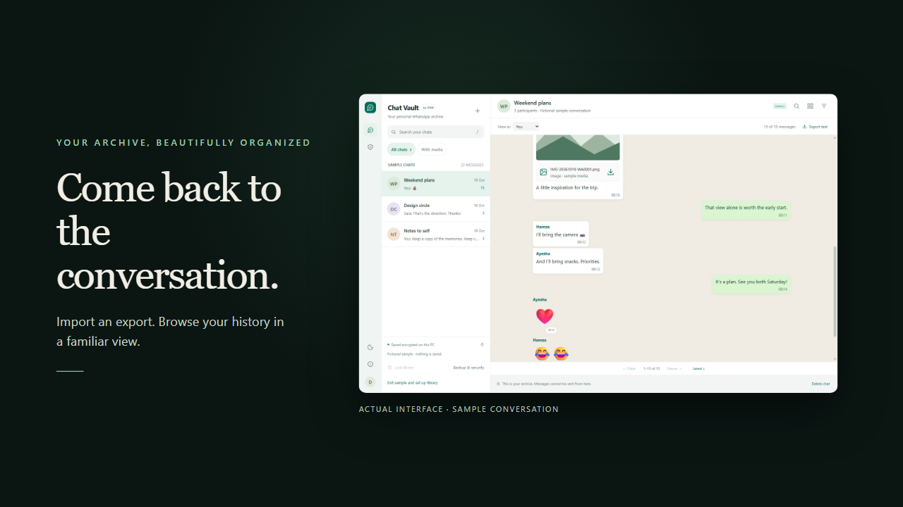
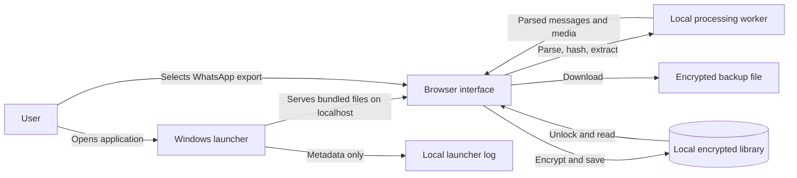
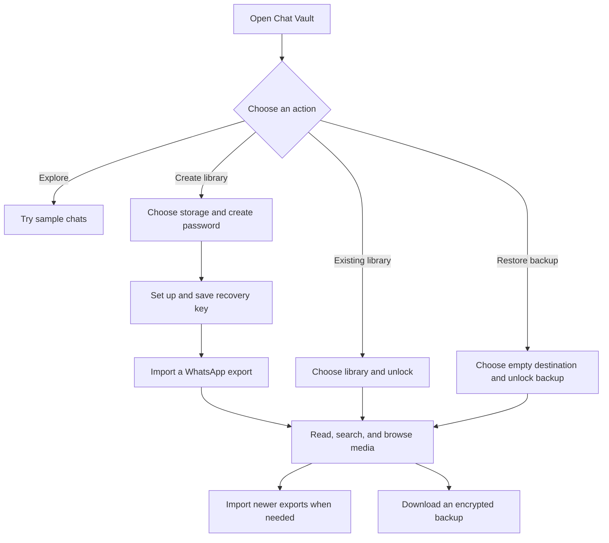

# DMK Chat Vault 2.0 for Windows

[](media/chat-vault-launch.webm)

**[Watch the 25-second product film](media/chat-vault-launch.webm)** · WebM with sound · fictional sample conversations

A private, local archive for exported WhatsApp conversations. Read chats in a familiar layout, search with surrounding context, browse included media, update earlier exports, and keep encrypted backups.

Chat Vault helps you preserve and explore a copy of your conversations on your own computer. It reads WhatsApp exports that you provide; it does not connect to your WhatsApp account, send messages, or synchronize chats. The application runs locally and does not require an account, an AI service, or an API key.

## At a glance

| Need | What Chat Vault provides |
| --- | --- |
| Explore an export | Search with surrounding messages, move between matches, filter by sender/date/media, and jump to the latest message. |
| Keep media together | Browse supported attachments and download other exported files. |
| Update an archive | Merge newer exports while preserving unmatched older history; undo the latest import if needed. |
| Protect a library | Encrypt saved records, change the password, set up a recovery key, and create encrypted backups. |
| Try before setup | Open sample chats without creating a library. |

## Start in a minute

1. Extract the complete portable ZIP into a folder you control.
2. Open **DMK-Chat-Vault.exe**. No console needs to stay visible.
3. Select **Try sample chats first** to explore without creating a library.
4. When ready, choose a separate library folder, create a password, and save your recovery key.
5. Import a WhatsApp TXT, ZIP, or RAR export. The on-screen guide explains exporting and transferring files from a phone.

Windows with Microsoft Edge or Google Chrome is required. Normal use needs no Node.js, Python, administrator installation, account, or internet connection. The native launcher is unsigned; these builds do not carry a publisher-signing certificate. Keep the complete extracted folder together.

For an optional per-user installation, run **Install.cmd**. It copies the application into `%LOCALAPPDATA%\Programs\DMK Chat Vault` and creates a Start-menu shortcut. Installation and updates keep your separately chosen library folder independent. Close an existing Chat Vault copy before updating.

Use **Close app** on the lock screen or sidebar to lock the library and stop the local launcher. Closing the last app window also releases its local launcher after a short grace period; abandoned window sessions expire after three minutes. Older `Start.cmd` entry points remain available. The single-file `app/offline.html` viewer also works without the desktop server.

## Your first library

The recommended location is a separate folder such as `Documents\Chat Vault Library`. The app explains the browser-profile storage alternative under **Other storage options**; clearing browser data can erase that alternative. Folder permissions are requested by the browser.

Create a password of at least 12 characters. Recovery setup opens after creation. Confirm the password, generate the recovery key, save it in a password manager or download/print it, then acknowledge that it is saved. The sidebar reports recovery status and the most recent backup preparation date.

The recovery key is shown once. Anyone with both the key and the encrypted vault can reset the password and read its chats. Keep it separate from the vault and backups. If setup is dismissed, use **Backup & security** to create a replacement key while you still know the password.

## Reading and searching

- Search keeps surrounding messages visible. Up/down buttons and Enter/Shift+Enter move through matches and wrap around the result list.
- The floating **Latest** button and Ctrl+End clear search and filters and go to the actual conversation ending.
- Sender, date and attachment filters remain available. Text export includes matching search results when a query is active, otherwise the current filtered messages.
- **View as** changes alignment. It does not invent message delivery or read receipts.
- Images, stickers, audio, videos and documents use the original exported files. Unsupported document formats are offered as downloads, never embedded as executable content.
- Messages are paginated; thumbnails are loaded lazily. Heavy hashing, parsing and archive extraction use a background worker when available. The app reports compatibility mode if that worker cannot start.
- **Stop import** cancels pending processing. A conversation already being saved finishes safely; later items are skipped.

Newer exports can update the same conversation. Matching retains repeated message occurrences and distinguishes attachment filenames and content checksums where available. Partial exports preserve unmatched older history. Ambiguous conversation identities ask for a choice. **Undo latest import** restores the previous saved version. Source exports remain encrypted with the library.

## Password changes and forgotten passwords

**Change password:** Unlock, open **Backup & security > Change password**, confirm the current password, and enter the new password twice. Chats and media are preserved. The recovery key stays valid.

**Forgot password:** Choose the existing library, select **Forgot password?**, enter its saved recovery key, and choose a new password. Recovery must have been set up before the password was forgotten. There is no cloud reset or universal recovery password.

**Replace a key:** Use **Replace recovery key** while unlocked. A replacement invalidates the earlier key for the current library. Older backups keep the password and key they had when created.

**Restore using a key:** Choose an empty destination and select a `.dmkvault` backup. Enable **Use a recovery key instead of the backup password**, enter that backup's recovery key, and choose a new library password.

The library automatically locks after 10 minutes without activity. The timeout can be set to 5, 10, 15 or 30 minutes. Operations already saving data finish before automatic locking.

## Backups and data integrity

Use **Download encrypted backup** regularly and keep the downloaded file separately. The app authenticates every required encrypted record before preparing a backup. Missing or corrupted required records cause backup preparation to fail visibly.

Restoration authenticates the complete backup before writing records, refuses an existing library, and rolls back partial files if a destination write fails. If storage access prevents rollback, the app reports that a different empty destination is needed. Keep enough free space for the restored encrypted records. Original archive exports are valuable independent copies.

The preparation date means the app generated a validated download; it cannot prove that the browser saved it or that you copied it elsewhere. Check the resulting file. Download a fresh backup after password or recovery-key changes.

Older v1 vaults and backups remain readable. Newly saved conversations use a structured record format that avoids reparsing message bodies. Use version 2.0 or later for newly written conversation records.

## Privacy, security and diagnostics

Chats are processed locally and encrypted before permanent storage with AES-256-GCM. PBKDF2-SHA-256 with 600,000 iterations protects the data-key envelope. Recovery uses a separate random 256-bit secret. Password changes update key protection without rewriting all media. Random IVs and record-specific authenticated data protect encrypted records.

The desktop server binds to `127.0.0.1:8765`, serves an explicit asset allowlist, and exposes version/health, authenticated window-lifetime and authenticated shutdown endpoints. Window-lifetime requests carry only a random window identifier. It accepts no chat-upload API. Host and Origin checks reject unrelated origins; control operations require a random per-launch token. Script and worker files are bundled; no analytics or remote AI service is used. The offline viewer has a hash-based Content Security Policy and a bundled worker.

Original WhatsApp exports, downloaded attachment/text files, recovery-key downloads, and exported JSONL logs remain unencrypted. An unlocked library can be accessed by a compromised device or browser extension. This product does not protect against a compromised operating system. Test results are not an independent security certification.

While unlocked, action metadata is written to encrypted `activity.bin`. Button activations and setting changes record stable control identifiers, not their displayed chat names or values. Domain events cover imports, search navigation, exports, locking, backups and credentials. No password, recovery key, query text, message text or participant name is intentionally recorded.

A bounded browser-profile diagnostic history records locked-state actions and logging failures. A visible sidebar notice reports activity-log write failures. Damaged encrypted log contents are preserved rather than silently replaced. Logs are diagnostic records, not an immutable or legally complete audit trail. Abrupt process termination may prevent the final pending event from being saved.

The desktop launcher rotates `%LOCALAPPDATA%\DMK Chat Vault\Logs\launcher.jsonl` at approximately 1 MB, retaining one previous file. It records startup, static request status and shutdown without control tokens. Export activity and diagnostics using **Download activity log**; the JSONL download is plain text. Encrypted backups include available encrypted activity history.

## Limits and platform support

- Windows desktop: Edge or Chrome. The browser-only/offline viewer is separate from Windows installation support.
- ZIP: 250 MB; RAR: 100 MB; TXT: 20 MB; attachment: 100 MB.
- ZIP expanded total: 750 MB; RAR expanded total: 250 MB; up to 25,000 archive entries and 15 transcripts per import archive.
- Up to 200 saved conversations and 200,000 messages per conversation; combined structured conversation records are limited to 50 MB.
- Encrypted backup download limit: 2 GB and 1,200 records. Larger folder vaults can be copied while the app is closed.
- Password-protected, split and ZIP64 archives are unsupported. Archive checks include declared-size limits, extraction bounds, duplicate filenames, unsafe paths and CRC verification.
- The interface is English. Unicode messages, native emoji, right-to-left content, numeric date ambiguity, and Arabic/Persian digits receive explicit handling. Unusual localized export formats can still require adjustment.
- WhatsApp exports contain only the information exported by WhatsApp. The viewer cannot send messages, automatically synchronize accounts, recover unexported/deleted history or restore conversations into WhatsApp.
- Large media exports still require substantial browser memory. Background processing improves responsiveness, not the size of the source data.

## Develop and verify

Node.js 22 or later is required for development; Node 24 is used in CI. No npm packages are required.

```powershell
node tools/build.js
node tests/run.js
node tests/browser.js
node tools/build.js --package
node tests/launcher.js
node tests/release.js
```

The browser suite launches Edge/Chrome with a new disposable profile and synthetic chats, leaving normal profiles and saved libraries alone. It verifies sample preview, recovery onboarding, background processing, contextual search, true latest navigation, password changes/reset, recovery-key restoration, private logs, mobile layout, idle locking and the standalone worker. Screenshots go to `tests/results/`, excluded from source/release archives. Set `CHROMIUM_PATH` if the browser is installed in a different location.

The Windows launcher suite uses a temporary port and install folder to check version/root identity, local HTTP protections, private-file isolation, shutdown authorization, log rotation and installer layout. Core regressions cover archives, Unicode, attachment identity, structured persistence, missing/corrupted records, restoration rollback, credentials, backward compatibility and stale-window writes.

`node tools/build.js --package` builds the native executable with the included Windows .NET Framework C# compiler, regenerates the standalone HTML, refreshes the source bundle, and writes the portable ZIP plus a SHA-256 checksum into the parent folder. Verify a downloaded ZIP with `Get-FileHash -Algorithm SHA256`. Packaging includes only approved runtime assets and development files, excluding vault records, recovery-key downloads, generated test results and user logs. The release suite verifies the checksum, every archive entry's CRC, required assets and source parity.

A Windows GitHub Actions workflow runs the build and the four verification suites. It uses the official [checkout](https://github.com/actions/checkout) and [setup-node](https://github.com/actions/setup-node) actions with read-only repository permissions. The workflow is included for future repository use; no remote run is claimed by a local build.

## Architecture and data flow

The desktop launcher serves the bundled interface on the local computer. The browser processes your selected exports, encrypts library records, and writes them to the folder you choose or to browser-profile storage. The standalone HTML viewer works without the desktop server.





The worker runs in the same browser on the same device. If workers are unavailable, the interface reports compatibility mode and processes work on the main thread. The diagrams describe the desktop path; they do not imply an internet service or automatic backup upload.

## Repository guide

| Path | Purpose |
| --- | --- |
| `app/` | Browser interface, local storage and encryption, archive handling, and worker code. |
| `tools/` | Build and packaging scripts and the Windows launcher source. |
| `tests/` | Core, browser, launcher, and release verification using synthetic data. |
| `licenses/` | Notices for bundled third-party archive components. |
| `.github/workflows/verify.yml` | Windows build and verification workflow. |
| `Start.ps1`, `Install.ps1` | Local server and optional per-user installation. |
| `SECURITY.md`, `CHANGELOG.md` | Security model and release history. |

## Configuration and secrets

The app has no external service credentials or API keys to configure, so no `.env` file is needed to run it. The launcher generates a fresh local control token at startup; it is not a reusable project secret. Create your library password in the app and store your recovery key separately in a secure location. Do not commit passwords, recovery keys, exports, libraries, backups, or personal logs to a repository, including inside an `.env` file.

Git ignore rules cover environment files, vault headers, backups, logs, private key files and common WhatsApp export names. Keep all personal exports and libraries outside the repository: filenames vary, so ignore rules cannot catch every private file. Ignore rules also do not remove files already tracked in Git or erase repository history; review staged files before publishing.

For browser verification only, `CHROMIUM_PATH` can point to an Edge or Chrome executable when the test cannot find one automatically. It is a file path, not a credential.

## Updates and support

Keep the application folder and library folder separate. Close the running application, extract or install the new version, and reopen the same library. A launcher refuses to silently reuse a different version or folder on its port. It reports how to close the earlier copy instead.

See `CHANGELOG.md` for changes and `SECURITY.md` for the supported security model. This project bundles third-party archive components; their licenses are in `licenses/`. Project licensing has not been supplied separately: do not infer new redistribution rights from this README.
